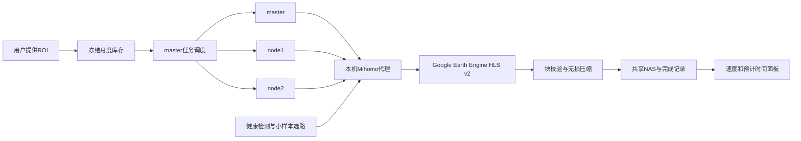

# HLS Download Manager

[](https://github.com/sdnufushiyuan/hls-download-manager/actions/workflows/ci.yml)
[](LICENSE)

基于 Google Earth Engine 的 HLS v2 下载与运行管理工具：按景保存 OPTRAM 输入，支持校验后断点续传、Linux 多节点调度、实时下载速度与工期估算，以及代理故障回退和保守的自动选路。

部署配置默认按估计剩余体量从小到大集中下载研究区，三个节点共同推进同一区的不同月份；该区全部月份通过核验后，再开始下一区。面板显示“已完成，可后续处理”后即可单独处理该区，无需等待六区全部结束。已有文件继续校验复用。

需要整图做NDVI–STR等特征空间分析时，可开启[按日整图处理](docs/daily-mosaics.md)：每个研究区、每天、每个产品输出一个固定范围的六波段TIFF，跨HLS瓦片拼接，L30/S30分别保留。还可额外生成同日L30优先、S30补缺的融合TIFF及像元来源/时刻图。独立后台任务处理已完成月份，保留下载块和进度；整图交付状态单独记录。

English: resumable HLS v2 OPTRAM archives, Linux cluster scheduling, verified tile downloads, live progress estimates, and adaptive proxy routing. Deployment instructions are currently in Chinese.

## 功能

- HLS L30 / S30，保留每次观测，输出30米的red、nir、swir2、NDVI、STR、Fmask六波段GeoTIFF。
- 原晴空/气溶胶规则、固定投影网格、同传感器精确时刻重叠像元去重；具体口径见[科学规则](docs/science.md)。
- 小块SHA256、波段、投影、网格、NoData及质量检查；有效缓存复用，临时文件不冒充完成。
- 每节点1–8路块下载；地址生成串行。master / node1 / node2共享月任务队列，网络异常有限重试。
- Linux systemd后台运行，关闭Windows、VS Code或进度面板不停止归档；需要正确配置用户服务和linger。
- 只读面板显示实际新落盘块/分钟、候选景处理速度、滚动剩余时间与预计完成日期。
- Mihomo原生故障回退，加上真实HLS小样本核验、连续确认和防抖的择优程序。
- 可选QQ SMTP故障邮件模块，不预置发件人、收件人或授权码。



## 支持范围

目标运行环境是**Linux、Python 3.11+、systemd用户服务和共享NAS**。Windows可用VS Code Remote SSH查看Linux任务，部分离线测试也能在Windows运行。

单ROI下载器和单ROI月调度可用于自行指定的研究区。v0.1的全档案库存、六区汇总面板采用SDR、REM、MES、RIS、OZN、TXS六区配置；需用户自行提供对应ROI。三个节点角色目前固定为master/node1/node2，源码、虚拟环境和输入路径应在节点间共享且保持相同绝对路径。这是研究工作流的初始公开版，尚未实现任意集群/任意区域集合的部署抽象。

仓库不含真实ROI、影像、下载进度、Google认证、代理节点、订阅、SSH密钥或SMTP授权码。Mihomo由用户从其官方项目单独安装。

## 快速试用单ROI

```bash
git clone https://github.com/sdnufushiyuan/hls-download-manager.git
cd hls-download-manager
python3 -m venv .venv
.venv/bin/python -m pip install -e .

# 本地预检：不认证、不联网、不写下载结果
.venv/bin/python download_hls_optram.py \
  --roi /path/to/your/roi.shp --start 2020-01-01 --end 2020-02-01 \
  --out /path/to/your/output --dry-run
```

先完成自己的Earth Engine账号认证，并指定已注册的Cloud项目：

```bash
.venv/bin/earthengine authenticate
export EE_PROJECT=your-earth-engine-project

# 使用已配置好的HTTP CONNECT代理；可直连时把 --proxy 改为 none
.venv/bin/python download_hls_optram.py \
  --roi /path/to/your/roi.shp --start 2020-01-01 --end 2020-02-01 \
  --out /path/to/your/output --proxy http://127.0.0.1:8118 \
  --workers 1 --limit 1
```

结束日期不包含在范围内。`--limit 1`只用于小规模验证；去掉后才按范围完整处理。Shapefile须有配套文件，或提供完整的ZIP包。指定米制CRS时使用`--crs EPSG:xxxxx`。

## 部署完整流程

按[部署文档](docs/deployment.md)完成：准备共享存储和免交互SSH → 填写私有配置 → 生成代理配置 → 试取一景并准备测速参考 → 冻结六区月度库存 → 审阅并安装用户服务 → 明确启动归档与自动选路。

配置从[examples](examples)复制到被Git忽略的`private/`。`tools/install_services.py`默认仅渲染服务，`--install`仅安装并重载systemd，**不会启用或启动下载**。

运行后在Linux终端打开面板：

```bash
.venv/bin/python tools/dashboard.py --config private/deployment.local.json
```

按Ctrl+C只退出面板。首次扫描库存和NAS记录可能较慢；工期需至少120秒及3个新增候选样本，之后按最近最多15分钟滚动估算。候选包含下载、复用及按质量规则跳过，不能当作字节进度。网络等待、区域差异和Google配额都会影响预测。

## 自动选路的含义

原生健康检测每30秒检查首选/回退组，每5分钟检查候选节点的Google HTTPS可达性与延迟。性能服务每5分钟抽测少量低延迟和轮转候选，每节点两轮真实128×128 HLS小块，并校验像元哈希。

正常性能切换要求同一候选连续两次巡检胜出、两轮都至少改善25%，且间隔至少10分钟。失效线路可走独立的原生回退。Google429、认证失败或缺少有效对照不能作为“节点拥堵”的证据。不会保证任意时刻绝对最快；小块测速也不等于大文件或多路吞吐。详细边界见[架构与选路](docs/architecture.md)。

## 项目结构

| 文件/目录 | 作用 |
|---|---|
| `download_hls_optram.py` | 下载、校验、并发和缓存 |
| `hls_download_selection.py` | 晴空检查与精确时刻重叠去重 |
| `run_hls_*.py` | 月度计划、节点生命周期和共享队列 |
| `watch_hls_progress.py` / `hls_progress_*.py` | 状态、速度、工期 |
| `hls_node_optimizer.py` | 有效小样本比较、选路和防抖 |
| `tools/` | 库存、私有配置、测速参考、服务安装和公开检查 |
| `examples/` | 全部为占位配置 |
| `test_*.py` | 合成数据与离线回归检查 |

## 测试

```bash
.venv/bin/python -m unittest discover -p 'test_*.py'
.venv/bin/python tools/check_public_tree.py
```

完整测试以Linux为准。CI在Python 3.11/3.13上执行离线测试、公开文件检查和构建，不使用实际账号或在线下载。详细行为说明见[排错文档](docs/troubleshooting.md)。

## 许可与上游

本项目使用[MIT许可](LICENSE)。Earth Engine、HLS数据、Python依赖和Mihomo分别遵循各自许可与使用条款；此仓库不附带Mihomo二进制，也不授权重新分发用户私有节点或研究数据。参考[上游说明](docs/upstream.md)。
